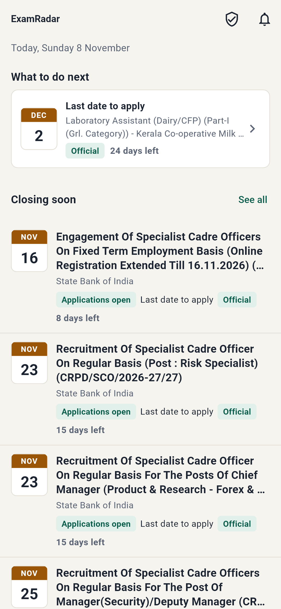
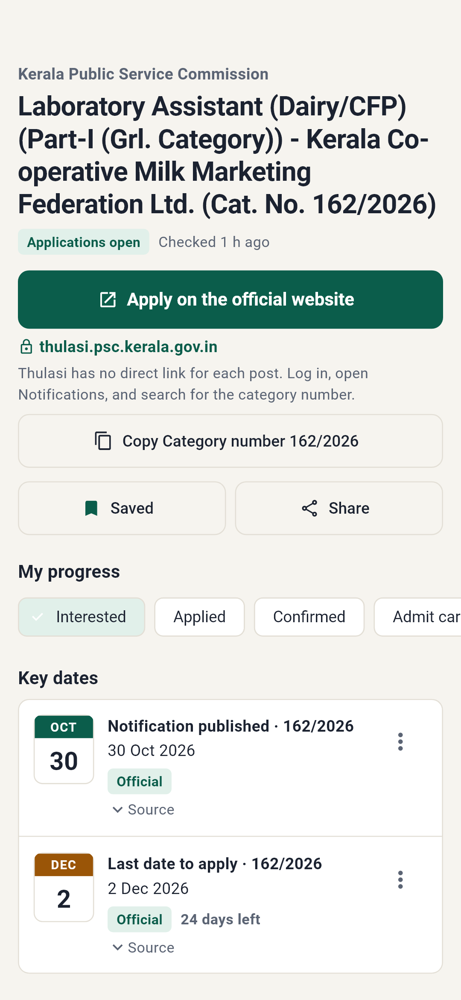
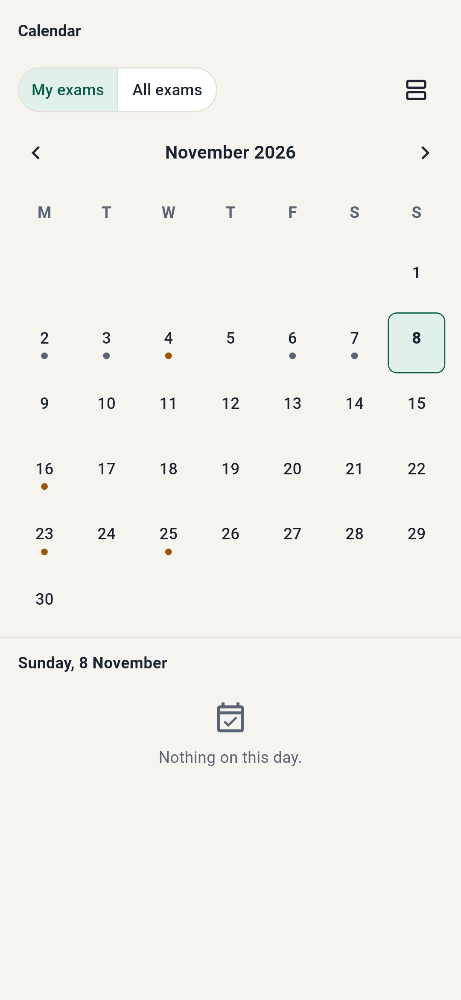

# ExamRadar

A verified tracker for Central and Kerala government exams. It reads official websites, keeps the original documents, shows every date with the exact sentence and page it came from, and reminds candidates what to do next.

ExamRadar is independent and not affiliated with any government body. Always confirm details on the linked official source.

| Home | Exam detail | Calendar |
|---|---|---|
|  |  |  |

## What works today

- **Collection** from Kerala PSC, SBI, IBPS, NTA, KDRB, RRB Thiruvananthapuram, SSC (rendered), and RBI's RSS. Tested live on 2026-11-08. UPSC blocks our crawler (HTTP 403), so UPSC needs manual entry or permission.
- **News signals** from publisher RSS feeds. They trigger official re-checks and admin review, and appear in the app only as labelled, unverified headlines.
- **Extraction** with evidence: dates, age limits, vacancies, fees, notification numbers, photo specs, and Kerala PSC programme tables, including confirmation deadlines. 100% precision and 95.6% recall on a 68-fact gold set (see `docs/evaluation.md`).
- **Review and revisions:** changed dates wait for an admin. Revisions are append-only. Retraction sends corrections.
- **Admin console** with TOTP login, review queue showing highlighted evidence, manual entry, source health, missed notices, fact checks, notification preview, and audit log.
- **Eligibility engine** per post, deterministic, with explanations, clauses, and age-limit projections.
- **Scam Check** for links, messages, and PDFs, with SSRF-safe fetching, lookalike detection, RDAP domain age, and official-record matching.
- **Android app** (Flutter): Home, Exams, Calendar, My Exams, exam detail, alerts, Scam Check, profile, readiness tools, source status, offline cache, local reminders, English and Malayalam, large text, and dark mode.

## Quick start

See `docs/setup.md`. In short:

```bash
python -m venv .venv && .venv/Scripts/pip install -e ".[dev]"
.venv/Scripts/examradar init-db && .venv/Scripts/examradar crawl kerala_psc sbi
.venv/Scripts/uvicorn examradar_api.main:app --host 0.0.0.0 --port 8000
cd apps/mobile && flutter build apk --release --split-per-abi --dart-define=API_BASE_URL=http://YOUR-PC-IP:8000
```

## Documents

- `docs/source-report.md`: what each official source supports, plus live-run findings
- `docs/architecture.md` and `docs/plan.md`: design and milestone status
- `docs/decisions.md`: decisions and open questions
- `docs/evaluation.md`: accuracy measurement
- `docs/setup.md`, `docs/deployment.md`: running and hosting
- `docs/security-review.md`, `docs/privacy-policy.md`, `docs/play-store-checklist.md`, `docs/legal-review.md`: release readiness

## Layout

```text
apps/mobile/                Flutter app
services/api/               FastAPI API, admin console, migrations
services/worker/            Pipeline, notifications, Celery tasks, CLI
packages/core/              Models, settings, storage
packages/source_adapters/   One adapter per official source, plus news signals
packages/extraction/        PDF, OCR, dates, Malayalam repair, rules, LLM fallback, validation
packages/eligibility/       Deterministic eligibility engine
config/                     Source registry and trusted intermediate certificates
data/fixtures/              Saved real official documents (with hashes)
data/gold/                  Hand-checked evaluation labels
tools/                      Dart model generator, evaluation script
```
